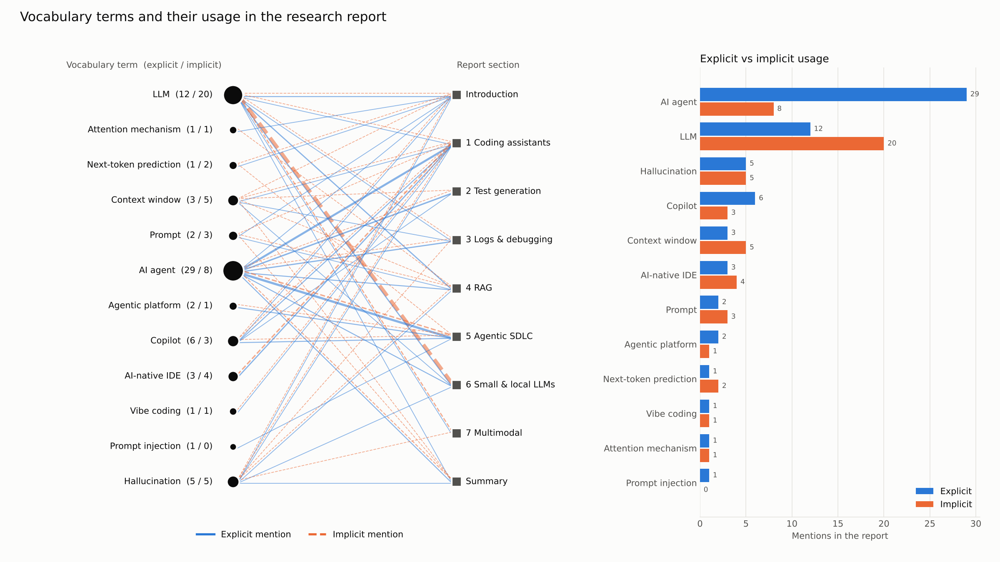

# Relationship graph: vocabulary terms vs. report usage

Optional subtask of Module 1. The graph links every term from [vocabulary.md](../vocabulary.md)
to the sections of [research-report.md](../research-report.md) where it is used.



Interactive version: download [relations_graph.html](relations_graph.html) and open it in a browser
(hover terms and sections, switch explicit / implicit, table view).

## How mentions are counted

- **Explicit** — the term itself or its direct forms (plural, abbreviation, full name), e.g. `LLM`, `LLMs`, `large language model`.
- **Implicit** — phrases that refer to the concept without naming it: synonyms, descriptions or concrete examples,
  e.g. `model` for *LLM*, `Cursor` for *AI-native IDE*, `natural language` for *vibe coding*.
- Explicit matches are counted first and masked, so one phrase is never counted twice.
  More specific terms are matched first (e.g. *prompt injection* before *prompt*). Link URLs are ignored.
- All patterns are listed in [terms_stats.json](terms_stats.json) and in [build_graph.py](build_graph.py).

## Results

| Term | Explicit | Implicit | Sections used |
|------|---------:|---------:|--------------:|
| AI agent | 29 | 8 | 8 / 9 |
| LLM | 12 | 20 | 7 / 9 |
| Hallucination | 5 | 5 | 7 / 9 |
| Copilot | 6 | 3 | 4 / 9 |
| Context window | 3 | 5 | 7 / 9 |
| AI-native IDE | 3 | 4 | 1 / 9 |
| Prompt | 2 | 3 | 4 / 9 |
| Next-token prediction | 1 | 2 | 2 / 9 |
| Agentic platform | 2 | 1 | 1 / 9 |
| Attention mechanism | 1 | 1 | 2 / 9 |
| Vibe coding | 1 | 1 | 1 / 9 |
| Prompt injection | 1 | 0 | 1 / 9 |

## Rebuild

```bash
pip install matplotlib
python build_graph.py
```
